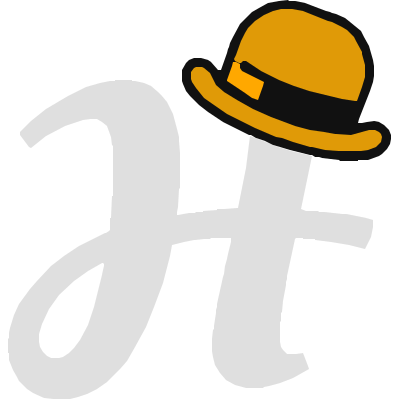

> [!WARNING]
>
>    This is project under development. Until version `0.3` is released, this repository will be unstable. Previous versions of the language are deprecated and not fully functioning.
>

<h1>

H-hat

</h1>

![version](https://img.shields.io/github/v/tag/hhat-lang/hhat_lang?label=version&color=orange&logo=data:image/svg%2bxml;base64,PHN2ZyB4bWxucz0iaHR0cDovL3d3dy53My5vcmcvMjAwMC9zdmciIHZpZXdCb3g9IjAgMCA0MDAgNDAwIj48cGF0aCBmaWxsPSIjZGZkZmRmIiBmaWxsLXJ1bGU9ImV2ZW5vZGQiIGQ9Ik0yMiAxMzBsLTIgMiAwIDMgOSAxMiAyIDEgMTUtMTIgMTktMTAgOS0zIDktMyA3LTEgNyAwIDUgMyA1IDQgNCAxMSAxIDggMSAxIDAgNSAwIDM1IDAgMSAwIDktMSAwLTEgMjItMSAwIDAgNiAwIDYtMSAxLTMgMi0xIDAtMTIgNi0xNCA3LTE1IDEwLTEzIDEwLTE0IDE1LTcgOC0xMSAxNS01IDExLTQgMTMtMSA1IDAgMSAwIDQtMSAxIDAgMTQgMSAwIDAgNyA0IDEwIDQgNyAyIDQgOCA4IDYgNCAxMSA1IDkgMSAxMyAwIDQgMCA4LTIgOS0zIDEwLTUgMTAtNyAxMy0xMyA3LTggOC0xNCAxMS0yMCA4LTIwIDktMjQgNy0yNyAyLTExIDEyLTMgMTAtMiAxIDAgOS0xIDYgMCAxLTEgOSAwIDEwIDAgMSAwIDAgNC0zIDEyLTEgNS0yIDctMSA4LTEgMy02IDI3IDAgMy0xIDMgMCAzLTIgMTMgMCAzLTEgMS0xIDkgMCAxIDAgMTAgMCAxIDEgNiAyIDggNSA4IDYgNyA5IDUgMTEgMyAxMCAwIDEgMCA2IDAgMS0xIDUtMSAxMS0zIDEzLTUgMTYtOS0xLTMtNS0xMy03IDEtOCAwLTEgMC00LTQtMi0zLTEtNSAwLTEzIDAtNyAxLTEgMC04IDEtMSAxLTExIDMtMTYgMC0zIDEtMyAwLTMgOC0zNyAxLTEgNyAwIDAgMSA2IDAgMSAwIDUgMCAwIDEgMTYgMiAxOCAzIDE2IDQgNi0xMiAyLTEwIDAtNy03LTItMjAtNC0zIDAtMSAwLTE4LTItNSAwLTEtMS0xMiAwLTUtMiAxMS01My0yMS01LTE2LTUtMSAwLTMtMi0yMS04LTQgMzItOCA0MC0xIDAtMTMgMS0xIDAtNiAwIDAgMS0xNCAxIDAgMS03IDAtMSAxLTYgMC0xMSAyLTEgMCAwLTMgMS01IDEtMTggMS0xIDAtOCAwLTI2IDAtMS0xLTEyIDAtNC0yLTgtNC0xNS02LTEyLTUtNi00LTQtNy02LTctMy05LTItMyAwIDAtMS0xNyAwIDAgMS01IDAtMTAgMi0xNCA0LTE4IDktMjIgMTMtMTUgMTJ6TTEwMyAyNjNsMSAxIDAgMi0xIDQtMSA1LTggMzItNiAxOC04IDE1LTYgOC01IDUtNiA0LTQgMS04IDAtNC0yLTQtNC0zLTUtMS01IDAtOCAzLTEwIDctMTUgMTAtMTQgMTUtMTQgMTQtMTAgMTQtOHoiLz48cGF0aCBmaWxsPSIjMTExIiBmaWxsLXJ1bGU9ImV2ZW5vZGQiIGQ9Ik0xODIgNzBsMCAxMSAxIDMgMyA3IDQgNSA5IDkgOSA3IDE1IDEwIDI2IDEzIDIgMCA1IDMgOSAzIDggNCA3IDIgMTAgMyAyMCA1IDIgMCAzIDIgNCAwIDMgMSAxNyAyIDEgMSAxOCAwIDAtMSAxMCAwIDExLTQgMy0yIDUtNSAzLTUgMS01IDAtNC0yLTUtNS01LTUtMy01LTEtNyAxLTUgMS0zIDAtMSAwIDEtNCAxMS0yOCAzLTkgMS02IDAtMSAwLTktMS02LTQtMTQtNS05LTMtNi0xMS05LTUtNC05LTQtNC0xLTItMS00LTEtMjEtOC0xMC0yLTYgMC0xLTEtOSAxLTExIDItOSA1LTcgNC0xMiAxMi03IDEzLTIgNC0xIDItMSA0LTEgMi0xIDQtNiAxNy0zIDAtNy04LTMtMi03LTItNyAwLTUgMi0zIDN6Ii8+PHBhdGggZmlsbD0iI2UwOWEwNyIgZmlsbC1ydWxlPSJldmVub2RkIiBkPSJNMTkxIDcybDAgNyAxIDMgNCA2IDggMTAgMTAgNyAxMyA5IDI4IDE0IDIxIDkgNiAxIDExIDQgMTcgNSAyIDAgMTMgMyAxMyAxIDIzIDAgNy0xIDgtMyA1LTUgMS01LTEtMy0yLTItNC0yLTYgMC0xOCA1LTE1LTEtMSAwLTExLTItMTQtMi0xNS00LTI0LTktMTgtOC0xNi05LTEzLTgtOC03LTYtMTItNi01LTItMS02IDAtMiAxek0yNDUgMzNsLTQgOC01IDE0LTIgNCAxIDIgNCAyIDIgMCAyLTIgMyAwIDE1IDEwIDE4IDkgMTUgNiAxNSA1IDMzIDggMTMgMiAyIDAgNS0xNCAzLTEwIDAtMTItMy0xMSAwLTItNi0xMS0yLTQtNy03LTUtMy0xMC01LTQtMS0yNS0xMC0xMS0yLTExIDAtOCAyLTkgNC05IDYtNyA3eiIvPjxwYXRoIGZpbGw9IiNmZmE4MDAiIGZpbGwtcnVsZT0iZXZlbm9kZCIgZD0iTTIzMyA2MmwtMSA0LTUgMTQgMCAxIDE4IDEyIDcgNSA2IDIgNS0xNCAxLTQtMjItMTEtMi0zIDAtNC00LTJ6Ii8+PC9zdmc+)

---

*H-hat is a rule system, compiler framework, and a statically typed, functional and distributed-system inspired, <u>hybrid quantum-classical programming language family</u>.*

**Targeted at _software developers_.** This ecosystem requires _<u>no prior knowledge on quantum physics</u>_. For quantum technologies to become widely available, they must _interoperate with existing software_, and must be easier for software developers to reason about the quantum paradigm without a PhD in quantum information or quantum computing. Most of the features are intuitive, both classical and quantum can exist in the same code, and the quantum side is as easy to code as in the classical one.

**Ships with _Heather dialect_.** A simple but reasonable programming language, Heather aims to demonstrate the capabilities of the H-hat ecosystem. Check it out at the [`hhat-heather` crate](rust/hhat_lang/dialects/heather).

**State-of-the-art software concepts.** Latest software paradigms and cutting-edge features are presented for both classical and quantum sides, enabling a seamless coding experience, with smart compilation. The features and capabilities H-hat aims to accomplish and delivery are briefly described at the paper 
["Toward Declarative Platform-Independent Modeling of Hybrid Quantum--Classical Software"](https://dl.acm.org/doi/10.1145/3837062.3839078).

**Building quantum open-source software.** Not only quantum software should advance, but we believe open-source is the backbone of world's most important software applications and tools. We are proudly supported by [UnitaryFoundation](https://unitary.foundation/grants/2023_h-hat/).

## Key Features

H-hat rule system defines how each dialect should behave in specific contexts. Below some of those rules are presented:

- **Classical and quantum entities** must be able to coexist in the same program.
- **Quantum paradigm** is a first-class entity just as its classical counterpart. It possesses _quantum types_, _literals_, _constants_, _variables_ and _functions_ that are denoted by the `@` prefix.
- **No quantum physics** properties such as qubits, quantum states, gates, circuits, pulses, Hamiltonians, or measurements are exposed to the user as language constructs. They are _handled internally by the compiler_, keeping the dialects platform-independent and problem-domain oriented.
- **Quantum functions** must be declarative in nature to keep the quantum model abstracted away from platform-specific definitions. Quantum low-level languages and target backends will define how each primitive quantum function is interpreted.
- **Quantum data** is lazily evaluated and linear, requiring a cast operator to realize it, to consume it and to drop it.

## Getting Started & Documentation

H-hat documentation can be found at https://docs.hhat-lang.org. Everything you need to get started, to install, to learn, to contribute, etc. will be available at the documentation website.

## License

MIT

## Contributing

Read the [CONTRIBUTING](CONTRIBUTING.md) file for more information.

## Code of Conduct

We coexist in the same world. So be nice to others as you expect others to be nice to you :)
